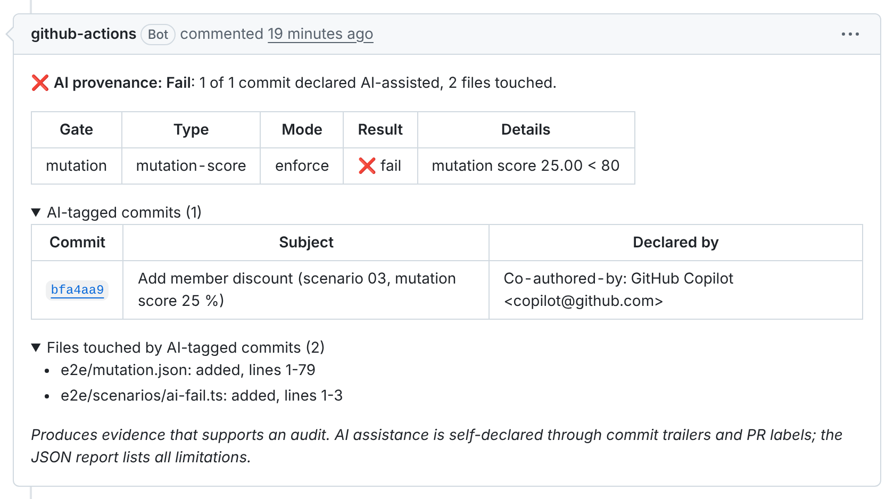
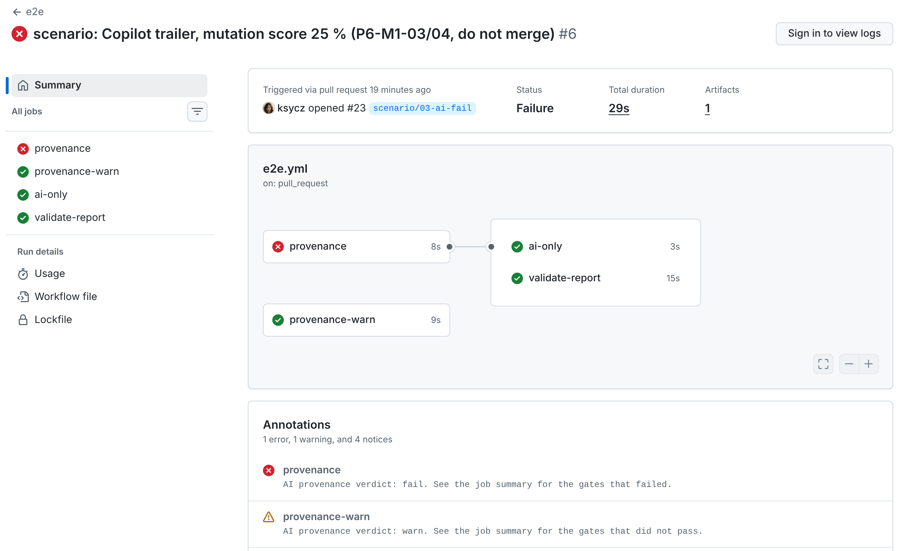

# AI Provenance Audit (`ai-provenance-action`)

Reusable GitHub Action that records **declared** AI-assisted pull-request changes, evaluates policy gates from other jobs, and publishes an audit report. It produces **evidence that supports an audit**; it does not detect AI code or certify compliance.

**Status:** Phases 1–5 are complete: the Action reads the PR and the base-branch policy, evaluates the gates, writes the job summary, uploads the JSON report and keeps one sticky PR comment up to date. Next: Phase 6, running it on real pull requests. See [docs/ROADMAP.md](./docs/ROADMAP.md), [docs/configuration.md](./docs/configuration.md), [docs/report-format.md](./docs/report-format.md) and [docs/threat-model.md](./docs/threat-model.md).

## What it looks like

On a pull request with AI-assisted commits, the Action keeps one comment up to date. Here the mutation gate fails, because the AI-touched code has a mutation score of 25 % against a threshold of 80 % ([scenario PR #23](https://github.com/ksycz/ai-provenance-action/pull/23)):



The same policy can run in warn mode. The enforce job fails the check, while the warn job stays green with a warning annotation:



More scenarios, including a passing PR and a PR from a fork, are in [docs/scenarios.md](./docs/scenarios.md).

## Quick start

Add a workflow that runs on pull requests. Until `v1` is released, point `uses:` at a commit SHA or at `./` inside this repository.

```yaml
name: ai-provenance
on:
  pull_request:
    types: [opened, synchronize, reopened, labeled, unlabeled]
  pull_request_review:
    types: [submitted, dismissed]

permissions:
  contents: read
  pull-requests: write # only needed for pr-comment: true

jobs:
  provenance:
    runs-on: ubuntu-latest
    steps:
      - uses: actions/checkout@v6
      - uses: ksycz/ai-provenance-action@v1 # not released yet
        with:
          pr-comment: "true"
```

`labeled` and `pull_request_review` re-run the check when someone adds the `ai-reviewed` label or approves, because gates are evaluated when the workflow runs.

## Permissions and fork pull requests

| Permission             | When                                    | Why                                                        |
| ---------------------- | --------------------------------------- | ---------------------------------------------------------- |
| `contents: read`       | always                                  | Read the config from the base branch and the commit diffs. |
| `pull-requests: read`  | always (part of `pull-requests: write`) | Read the PR, its commits and reviews.                      |
| `pull-requests: write` | only with `pr-comment: true`            | Create or update the sticky PR comment.                    |

**Pull requests from forks** get a read-only `GITHUB_TOKEN`. The check still runs and still sets the verdict, writes the job summary and uploads the report artifact. Only the PR comment is skipped, with a notice explaining why.

**Do not use `pull_request_target` for this Action.** It runs with a write token and secrets in the context of the base repository. Workflows that check out and run code from the fork under that trigger are a well-known way to leak secrets or tamper with the repository. This Action needs neither secrets nor write access to produce its evidence. The policy is already protected because it is read from the base branch, so plain `pull_request` is the safe choice. The price is the skipped comment on fork PRs.

## Inputs

| Input             | Default                     | Purpose                                                                                                  |
| ----------------- | --------------------------- | -------------------------------------------------------------------------------------------------------- |
| `github-token`    | `${{ github.token }}`       | Token for the GitHub REST API. Needs `contents: read` and `pull-requests: read`.                         |
| `config-path`     | `.github/ai-provenance.yml` | Where the policy file lives. It is always read from the PR's base branch.                                |
| `mutation-report` | _(empty)_                   | Path to a Stryker `mutation.json` written by an earlier step. Must be inside the workspace.              |
| `report-path`     | `ai-provenance-report.json` | Where to write the JSON report, inside the workspace.                                                    |
| `upload-artifact` | `true`                      | Upload the report as the artifact `ai-provenance-<pr>-<run_attempt>`.                                    |
| `pr-comment`      | `false`                     | Create or update one sticky PR comment. Needs `pull-requests: write`; skipped with a notice on fork PRs. |

## Outputs

| Output        | Example                     | Purpose                                                                        |
| ------------- | --------------------------- | ------------------------------------------------------------------------------ |
| `ai_tagged`   | `true`                      | Whether any commit or PR label was declared AI-assisted.                       |
| `ai_files`    | `["src/a.ts"]`              | JSON array of files touched by AI-tagged commits.                              |
| `report_path` | `ai-provenance-report.json` | Path of the written JSON report.                                               |
| `verdict`     | `pass`                      | Overall policy result: `pass`, `warn` or `fail`. A `fail` also fails the step. |

## Development

```bash
nvm use
npm ci
npm run ci
```

## Tooling choices

Short rationale for libraries named in the roadmap—helpful when skimming the repo.

**nock** — HTTP mocking for Node test runs. Phase 5 adapter tests call the GitHub REST API through `@actions/github`; nock intercepts those requests in-process and returns fixtures, so CI never needs network access and cases like pagination or rate limits stay deterministic. [MSW](https://mswjs.io/) is the usual alternative if you want the same pattern in browser and Node tests; stubbing Octokit by hand is lighter but less faithful to real URLs and headers.

**Rollup** — Bundles `src/main.ts` into a single committed `dist/index.cjs` that the Action executes on the runner (`.cjs`, because `package.json` sets `"type": "module"` and the bundle is CommonJS). GitHub Actions expect a self-contained entry file; Rollup tree-shakes and keeps the bundle explicit. Many Actions use `@vercel/ncc` or **esbuild** (often via **tsup**) instead for speed; Rollup was chosen here for a clear build graph and a committed artifact checked by the `check-dist` workflow.

**Ajv** — Validates YAML-backed config and the JSON audit report against checked-in JSON Schema files (`schema/*.schema.json`). Phase 2 can surface errors at the YAML path (e.g. `policy.gates[0].threshold`) for adopters. **Zod** or **Valibot** are strong when TypeScript types are the source of truth; Ajv fits when the schema files are the contract (editor completion, report versioning docs).

**ESLint and Prettier** — ESLint (with **typescript-eslint**) enforces style and rules such as “`src/core/` must not import `@actions/*` or adapters”; **dependency-cruiser** enforces the same boundary in CI. **Biome** can replace ESLint + Prettier in one fast tool; **Oxlint** is often added for speed, not as a full replacement. This repo keeps the widespread ESLint + Prettier split so custom architectural rules stay straightforward in a portfolio and on the Marketplace.
