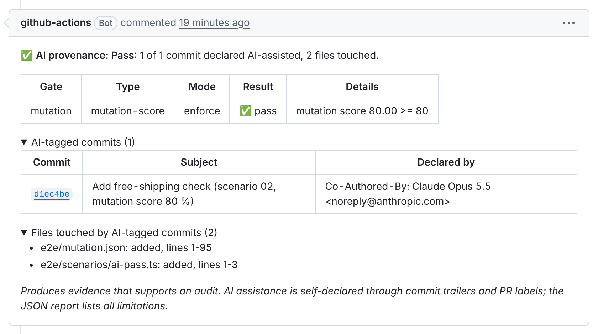
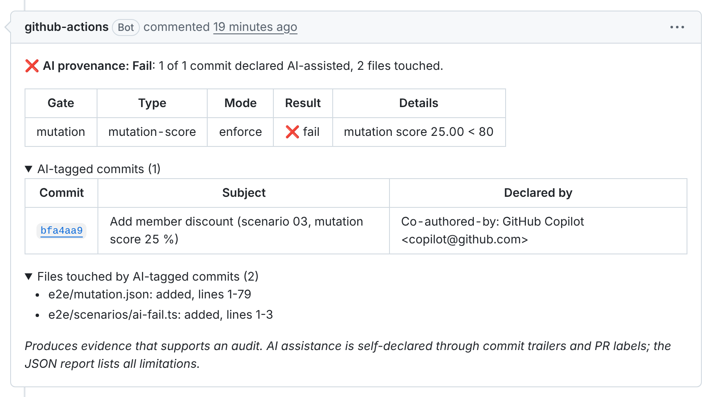
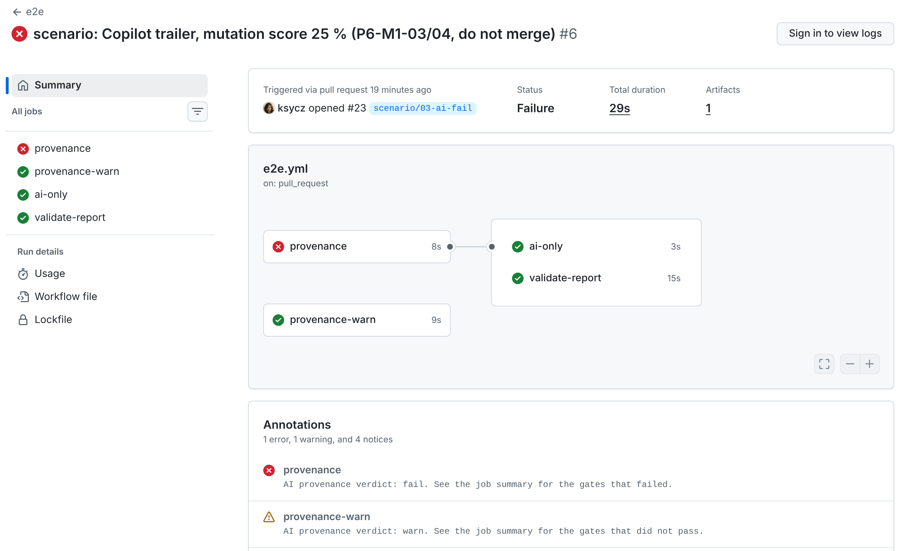
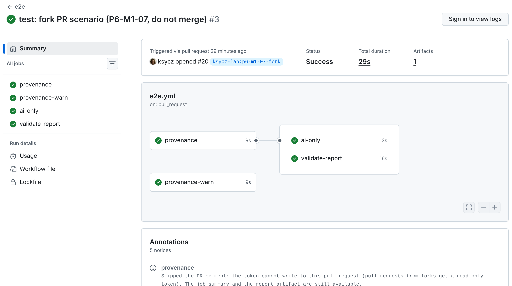

# End-to-end scenarios

The `e2e` workflow (`.github/workflows/e2e.yml`) runs the bundled Action (`uses: ./`) on every pull request to `main`. It uses this repository's own policy (`.github/ai-provenance.yml`): a mutation gate at 80 % on AI-touched files, skipped when there is no mutation report.

Each scenario below is a long-lived draft pull request that shows one outcome on real GitHub. It is never merged. All results were checked on 2026-11-09.

| ID       | Scenario                             | Pull request and run                                                                                                                                                                                                           | Result                                                                                                                                            |
| -------- | ------------------------------------ | ------------------------------------------------------------------------------------------------------------------------------------------------------------------------------------------------------------------------------ | ------------------------------------------------------------------------------------------------------------------------------------------------- |
| P6-M1-01 | No AI trailers                       | [#21](https://github.com/ksycz/ai-provenance-action/pull/21), [run](https://github.com/ksycz/ai-provenance-action/actions/runs/42583770685)                                                                                    | `provenance` ✅ `pass`, one-line summary; `ai-only` skipped; no PR comment                                                                        |
| P6-M1-02 | Claude trailer, mutation score 80 %  | [#22](https://github.com/ksycz/ai-provenance-action/pull/22), [run](https://github.com/ksycz/ai-provenance-action/actions/runs/42583772858)                                                                                    | `provenance` ✅ `pass`; comment shows "mutation score 80.00 >= 80"                                                                                |
| P6-M1-03 | Copilot trailer, mutation score 25 % | [#23](https://github.com/ksycz/ai-provenance-action/pull/23), [run](https://github.com/ksycz/ai-provenance-action/actions/runs/42583775663)                                                                                    | `provenance` ❌ `fail` (on purpose); comment shows "mutation score 25.00 < 80"                                                                    |
| P6-M1-04 | Same PR, warn-mode policy            | [#23](https://github.com/ksycz/ai-provenance-action/pull/23), same run                                                                                                                                                         | `provenance-warn` ✅ green with the warning "AI provenance verdict: warn"                                                                         |
| P6-M1-05 | Downstream job on `ai_tagged`        | #20, #22 and #23 versus #21                                                                                                                                                                                                    | `ai-only` runs on the AI-tagged PRs and is skipped on #21                                                                                         |
| P6-M1-06 | Squash merge of a tagged PR          | [#24](https://github.com/ksycz/ai-provenance-action/pull/24), runs [1](https://github.com/ksycz/ai-provenance-action/actions/runs/42584794901) and [2](https://github.com/ksycz/ai-provenance-action/actions/runs/42586190349) | squash commit `a6a3055` on `main` has no `Co-Authored-By` trailer; the PR's comment and report still list both commits with their Claude trailers |
| P6-M1-07 | PR from a fork (`ksycz-lab`)         | [#20](https://github.com/ksycz/ai-provenance-action/pull/20), [run](https://github.com/ksycz/ai-provenance-action/actions/runs/42582621458)                                                                                    | `provenance` ✅; notice "Skipped the PR comment…"; token `PullRequests: read`; no comment; report `isFork: true`                                  |
| P6-M1-08 | Artifact validation                  | every PR above                                                                                                                                                                                                                 | `validate-report` ✅ downloads the artifact and checks it against `schema/report.v1.schema.json`                                                  |
| P6-M1-09 | The bundle starts on a runner        | every PR above                                                                                                                                                                                                                 | the Action starts from `dist/index.cjs`; the first real run, before the fix, failed with `require is not defined`                                 |

## Screenshots

Taken on 2026-11-09 from the public pages, logged out.

**P6-M1-02, pass (#22).** The sticky PR comment with the mutation gate at exactly the threshold:

**P6-M1-03, fail (#23).** The same comment, failing at 25 %:

**P6-M1-03 and P6-M1-04 (#23).** The enforce job fails; the warn-mode job stays green with a warning. `ai-only` and `validate-report` still run:

**P6-M1-07, fork PR (#20).** All jobs are green. The comment is skipped with a notice, because fork PRs get a read-only token:

The job summaries are only visible when signed in to GitHub, so they are not shown here. They have the same content as the PR comments.

## How the scenario PRs are built

- **Fork PR.** #20 comes from a fork in the organization `ksycz-lab`, so GitHub gives its workflow a read-only token. No second account is needed.
- **Mutation reports.** The scenario PRs carry a small Stryker-format report at `e2e/mutation.json`. It stands in for a mutation-testing job, and covers only the file the AI-tagged commit adds. Ordinary PRs have no such file, so the mutation gate is skipped there (`on-missing: skip`).
- **Trailers.** The commits in #21 and #23 deliberately do not carry the usual `Co-Authored-By: Claude` line: #21 must have no AI trailer, and #23 shows a Copilot trailer on its own.
